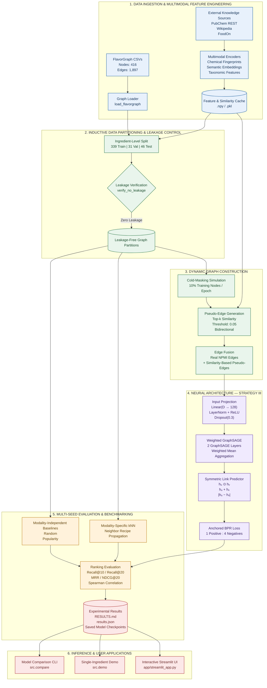

# SavorLink Architecture & System Specification

This document provides the definitive architectural specification for the **Let There Be Flavour / SavorLink** project. It details the system design, inductive learning constraints, neural network mathematical formulations, and descriptions of all current and overall execution pipelines.

For the project overview, latest benchmark results, and academic paper references, see [README.md](README.md). For environment setup, see [setup.md](setup.md). For specialized deep dives, refer to the [docs/](docs/) directory.

---

## Table of Contents

1. [Architectural Philosophy](#1-architectural-philosophy)
2. [High-Level System Architecture](#2-high-level-system-architecture)
3. [Description of Pipelines](#3-description-of-pipelines)
   - [3.1 Overall End-to-End Pipeline](#31-overall-end-to-end-pipeline)
   - [3.2 Data Ingestion & Hub Filtering Pipeline](#32-data-ingestion--hub-filtering-pipeline)
   - [3.3 Multi-Modal Feature Extraction & Similarity Cache Pipeline](#33-multi-modal-feature-extraction--similarity-cache-pipeline)
   - [3.4 Inductive Splitting & Leakage Verification Pipeline](#34-inductive-splitting--leakage-verification-pipeline)
   - [3.5 Dynamic Pseudo-Edge Construction Pipeline](#35-dynamic-pseudo-edge-construction-pipeline)
   - [3.6 Inductive GNN Training & Optimization Pipeline](#36-inductive-gnn-training--optimization-pipeline)
   - [3.7 Multi-Seed Benchmarking & Evaluation Pipeline](#37-multi-seed-benchmarking--evaluation-pipeline)
   - [3.8 Inference & Interactive Web Serving Pipeline](#38-inference--interactive-web-serving-pipeline)
   - [3.9 Google Colab Cloud Training Pipeline](#39-google-colab-cloud-training-pipeline)
4. [Source Code Module Inventory](#4-source-code-module-inventory)
5. [Model Architecture: Strategy III Inductive GNN](#5-model-architecture-strategy-iii-inductive-gnn)
   - [5.1 Input Projection Layer](#51-input-projection-layer)
   - [5.2 Weighted GraphSAGE Encoder (Branch A)](#52-weighted-graphsage-encoder-branch-a)
   - [5.3 Optional Cuisine Modulation (Branch B) & Gated Fusion](#53-optional-cuisine-modulation-branch-b--gated-fusion)
   - [5.4 Symmetric Link Prediction Head](#54-symmetric-link-prediction-head)
   - [5.5 Anchored Bayesian Personalized Ranking (BPR) Loss](#55-anchored-bayesian-personalized-ranking-bpr-loss)
   - [5.6 Cold-Masking Inductive Training Protocol](#56-cold-masking-inductive-training-protocol)
6. [Design Decisions & Scientific Post-Mortem](#6-design-decisions--scientific-post-mortem)
7. [Hardware Compliance & Free-Tier Budgeting](#7-hardware-compliance--free-tier-budgeting)

---

## 1. Architectural Philosophy

Standard Graph Neural Networks (GNNs) and transductive link prediction frameworks (e.g., Node2Vec, TransE, standard GCN) rely on learned per-node embedding matrices $\mathbf{E} \in \mathbb{R}^{|V| \times d}$ or assume that test nodes already possess topological connectivity to propagate messages.

In the **zero-degree cold-start food pairing problem**, a newly introduced culinary ingredient (e.g., a regional fruit like jackfruit or a novel synthetic flavor) has **zero recipe co-occurrence edges**. Under this constraint:
1. **Zero Transductive Embeddings:** An `nn.Embedding(num_nodes)` table cannot represent an unseen or cold ingredient. The architecture must be **strictly inductive**, embedding nodes solely through their multi-modal intrinsic features $\mathbf{x} \in \mathbb{R}^D$ and dynamic topology.
2. **Strategy III Pseudo-Edge Bridge:** Message passing fails on isolated nodes ($\text{degree} = 0$). SavorLink "Strategy III" dynamically bridges cold nodes into the warm recipe graph by synthesizing **weighted pseudo-edges** connecting the cold node to its top-$k$ nearest known hub ingredients based on feature similarity.
3. **Symmetric Invariance:** Food pairing affinity is inherently undirected and symmetric: $\text{score}(u, v) \equiv \text{score}(v, u)$. The neural scoring head must mathematically enforce this property.
4. **Honest Baseline Calibration:** If inductive neural message passing cannot outperform simple neighbor propagation (kNN) or global ingredient popularity, the evaluation protocol must make this transparent.

---

## 2. High-Level System Architecture


## System Architecture 




---

## 3. Description of Pipelines

The codebase contains nine discrete pipelines organized into data ingestion, feature generation, inductive partitioning, dynamic graph construction, neural training, benchmarking, serving, and cloud orchestration.

### 3.1 Overall End-to-End Pipeline
- **Orchestrator:** `setup.bat` (Windows) or manual execution sequence
- **Function:** Executes the complete journey from raw inputs to trained models and visual serving.
- **Workflow:**
  1. Validates environment and dependencies (`requirements.txt`).
  2. Runs 19 automated tests (`tests/run_tests.py`).
  3. Executes multi-modal multi-seed benchmark (`src/run_benchmark.py`).
  4. Parses results into structured summaries (`results/results.json`, `results/RESULTS.md`).
  5. Launches interactive web application (`app/streamlit_app.py`) and terminal comparison (`src/compare.py`).

### 3.2 Data Ingestion & Hub Filtering Pipeline
- **Source Module:** `src/data/loaders.py`
- **Function:** Ingests raw FlavorGraph CSVs, validates node types, and performs hub-only filtering.
- **Detailed Operation:**
  - Reads `nodes_191120.csv` into typed `NodeInfo` dataclasses.
  - Reads `edges_191120.csv` into typed `EdgeInfo` dataclasses.
  - In `hub_only` mode (default), filters out all non-hub ingredients (which lack compound links and would otherwise introduce 6,236 zero-vectors into the feature space).
  - Retains 416 hub ingredients and 1,897 undirected Recipe1M NPMI co-occurrence edges.

### 3.3 Multi-Modal Feature Extraction & Similarity Cache Pipeline
- **Source Modules:** `src/chem/`, `src/data/pubchem_lookup.py`, `src/data/semantic_lookup.py`, `src/data/taxonomic_lookup.py`, `src/data/build_all_modalities.py`
- **Function:** Converts biological, textual, and categorical metadata into dense feature matrices and sparse top-$k$ similarity dictionaries.
- **Detailed Operation:**
  - **Molecular:** Fetches PubChem SMILES $\rightarrow$ RDKit 2048-bit Morgan fingerprints ($r=2$) $\rightarrow$ mean pooling across compounds $\rightarrow$ set-level Mean Best Match (MBM) Tanimoto top-10.
  - **Semantic:** Retrieves ingredient descriptions $\rightarrow$ `all-MiniLM-L6-v2` dense embeddings ($384\text{-d}$, $L_2$-normalized) $\rightarrow$ cosine similarity top-10.
  - **Taxonomic:** Maps ingredients to a 3-level food hierarchy $\rightarrow$ 141-d multi-hot encoding $\rightarrow$ Wu-Palmer ontological tree similarity top-10.
  - **Hybrid:** Concatenates normalized molecular and semantic vectors ($2432\text{-d}$) $\rightarrow$ blended similarity ($0.5 \times \text{molecular} + 0.5 \times \text{semantic}$).

### 3.4 Inductive Splitting & Leakage Verification Pipeline
- **Source Module:** `src/data/splits.py`
- **Function:** Partitions ingredients and isolates ground-truth test edges without target or topological leakage.
- **Detailed Operation:**
  - Filters eligible hubs by minimum Recipe1M degree ($\text{degree} \ge 5$, yielding 311 eligible hubs).
  - Partitions nodes into 339 train, 31 validation, and 46 test ingredients per seed.
  - Severs all edges incident to validation and test nodes from the training graph.
  - Removed edges with $\text{NPMI} > 0$ become ground-truth pairing targets (562 test pairs, 351 val pairs per seed).
  - Runs `verify_no_leakage` to assert disjoint node sets and ensure pseudo-edges and kNN candidates never leak held-out nodes.

### 3.5 Dynamic Pseudo-Edge Construction Pipeline
- **Source Modules:** `src/graph/pseudo_edges.py`, `src/graph/build_graph.py`
- **Function:** Constructs synthetic weighted edges connecting isolated cold nodes to known training hubs.
- **Detailed Operation:**
  - Queries precomputed similarity caches for the cold node's top-$k$ neighbors.
  - Excludes any neighbor belonging to held-out test or validation splits.
  - Drops connections below similarity threshold ($\tau = 0.05$).
  - Injects bidirectional edges with similarity weights $w_{uv} \in (0, 1]$.
  - Merges pseudo-edges with real recipe edges ($w_{\text{real}} \in (0, 1]$) into unified PyTorch tensors (`edge_index`, `edge_weight`, `is_pseudo`).

### 3.6 Inductive GNN Training & Optimization Pipeline
- **Source Modules:** `src/train.py`, `src/models/`
- **Function:** Trains Strategy III inductive GNN with cold-masking and anchored ranking loss.
- **Detailed Operation:**
  - **Cold-Masking:** Randomly masks 10% of training nodes per epoch, removes their recipe edges, and injects dynamic pseudo-edges.
  - **Forward Pass:** Encodes nodes via 2-layer `WeightedSAGEConv`.
  - **Pair Scoring:** Evaluates symmetric MLP head on positive and anchored negative pairs.
  - **Anchored BPR Loss:** Compares each positive $(u, v^+)$ against 4 sampled negatives $(u, w^-)$ sharing anchor $u$.
  - **Scheduler & Early Stopping:** `ReduceLROnPlateau` decays LR on validation stagnation; early stopping triggers after 15 epochs without improvement.

### 3.7 Multi-Seed Benchmarking & Evaluation Pipeline
- **Source Modules:** `src/run_benchmark.py`, `src/evaluate.py`, `src/baselines.py`, `src/compare.py`
- **Function:** Evaluates all 5 models across 4 modalities and 3 seeds under identical test conditions.
- **Detailed Operation:**
  - Evaluates Random, Popularity, kNN Baseline, Zero-Degree GNN, and Strategy III on 46 held-out test ingredients.
  - Each cold node ranks all 415 candidate hubs.
  - Computes Recall@10, Recall@20, MRR, NDCG@20, and Spearman $\rho$.
  - Averages metrics across seeds 42, 123, 456, recording mean $\pm$ standard deviation.
  - Emits `results/RESULTS.md` and `results/results.json`.

### 3.8 Inference & Interactive Web Serving Pipeline
- **Source Modules:** `src/inference.py`, `src/demo.py`, `app/streamlit_app.py`
- **Function:** Provides interactive graphical and CLI exploration of cold-start predictions.
- **Detailed Operation:**
  - `SavorLinkPredictor` loads serialized weights (`model_seed42.pt`), graph metadata, and feature arrays.
  - Masks candidate query ingredient, injects pseudo-edges, and outputs ranked recommendations alongside kNN baseline predictions.
  - Streamlit UI exposes 4 functional tabs: Overview, Multi-Modal Benchmark Analytics, Interactive Cold-Start Lab, and Semantic Context Inspection.

### 3.9 Google Colab Cloud Training Pipeline
- **Source Modules:** `src/export_colab_bundle.py`, `notebooks/colab_gpu_training.ipynb`
- **Function:** Bundles repository assets for one-click GPU execution in Google Colab.
- **Detailed Operation:**
  - `export_colab_bundle.py` packs `configs/`, `data/raw/`, `data/cache/`, and `src/` into `data/colab_training_bundle.zip` ($\approx 4\text{ MB}$).
  - Colab notebook detects CUDA GPU, extracts bundle, runs multi-seed benchmark under CUDA, prints markdown report, and zips results for download.

---

## 4. Source Code Module Inventory

| File Path | Functional Responsibility |
|---|---|
| `configs/default.yaml` | Master configuration containing all paths, hyperparameter grids, and runtime flags. |
| `src/data/loaders.py` | CSV parsing for FlavorGraph nodes/edges, typed dataclasses, hub-only filtering, adjacency indexing. |
| `src/data/splits.py` | Ingredient-level disjoint partitioning, degree filtering, edge removal, and `verify_no_leakage`. |
| `src/data/walk_loader.py` | Optional metapath random-walk loader for FlavorGraph (disabled by default; see §6). |
| `src/data/pubchem_lookup.py` | Rate-limited, resumable JSON caching for PubChem REST API queries. |
| `src/data/semantic_lookup.py` | Textual description retrieval from Wikipedia with fallback culinary templates. |
| `src/data/taxonomic_lookup.py` | Rule-based 3-level food hierarchy lookup (`TAXONOMIC_RULES`). |
| `src/data/build_all_modalities.py` | Offline cache builder generating all `.npy` and `.pkl` assets in `data/cache/`. |
| `src/chem/fingerprints.py` | RDKit Morgan fingerprint extraction ($r=2, 2048\text{-bit}$) and continuous mean pooling. |
| `src/chem/similarity.py` | Vectorized binary/continuous Tanimoto, set-level Mean Best Match, and sparse top-$k$ selection. |
| `src/chem/semantic_embeddings.py` | Sentence-transformer embedding generation (`all-MiniLM-L6-v2`) and cosine similarity top-$k$. |
| `src/chem/taxonomic_similarity.py` | Multi-hot hierarchical taxonomy encoding and Wu-Palmer tree similarity. |
| `src/chem/hybrid_similarity.py` | Feature vector concatenation ($2432\text{-d}$) and blended top-$k$ similarity selection. |
| `src/graph/pseudo_edges.py` | Injects synthetic weighted pseudo-edges between cold nodes and training hubs; edge merging. |
| `src/graph/build_graph.py` | Canonical node ID mapping and feature matrix assembly. |
| `src/models/branches.py` | Custom `WeightedSAGEConv` (pure PyTorch weighted mean aggregation), `WeightedGATConv`, `BranchA`, and `BranchB`. |
| `src/models/heads.py` | Permutation-invariant `LinkPredictionHead` and `GatedFusion`. |
| `src/models/strategy3.py` | Full `Strategy3Model` assembling branches, head, and loss functions (BPR, Huber, BCE). |
| `src/baselines.py` | Implementation of Random, Popularity, and Modality-Agnostic kNN baselines. |
| `src/evaluate.py` | Metric computation (Recall@K, MRR, NDCG@K, Spearman $\rho$) and Markdown table formatting. |
| `src/train.py` | Main training engine: cold-masking loop, anchored BPR loss, validation early stopping, artifact export. |
| `src/run_benchmark.py` | Multi-seed, multi-modality benchmarking orchestrator writing `results/RESULTS.md` and `results/results.json`. |
| `src/compare.py` | Terminal-based comparative analytics tool (head-to-head, leaderboard, verdict). |
| `src/inference.py` | `SavorLinkPredictor` inference engine for single-ingredient or batch recommendations. |
| `src/demo.py` | Interactive CLI demo scoring cold test ingredients. |
| `src/export_colab_bundle.py` | Packages repository code and precomputed data into `data/colab_training_bundle.zip`. |
| `app/streamlit_app.py` | Interactive Streamlit web application. |
| `tests/run_tests.py` | 19-test standalone test runner. |

---

## 5. Model Architecture: Strategy III Inductive GNN

```
                          Node Features x_u in R^D
                                     │
                                     ▼
                     Linear(D -> 128) + LayerNorm + ReLU + Dropout(0.3)
                                     │
                                     ▼
                     h_u^(0) in R^128 (Initial Representation)
                                     │
       ┌─────────────────────────────┴─────────────────────────────┐
       │                                                           │
       ▼                                                           ▼
WeightedSAGEConv (Layer 1)                                   WeightedSAGEConv (Layer 2)
  - Message: m_v = w_uv * h_v                                  - Message: m_v = w_uv * h_v
  - Aggregation: sum(m_v) / (sum(w_uv) + eps)                  - Aggregation: sum(m_v) / (sum(w_uv) + eps)
  - Update: ReLU(W1*h_u + W2*agg)                              - Update: ReLU(W1*h_u + W2*agg)
       │                                                           │
       └─────────────────────────────┬─────────────────────────────┘
                                     │
                                     ▼
                       Latent Embedding h_u in R^128
                                     │
                    Pair Representation phi(u, v) in R^384
               [h_u ⊙ h_v  ||  h_u + h_v  ||  |h_u - h_v|]
                                     │
                                     ▼
                 MLP: Linear(384 -> 64) -> ReLU -> Linear(64 -> 1)
                                     │
                                     ▼
                        Pairing Affinity Logit s(u, v)
```

### 5.1 Input Projection Layer
Given raw feature vector $\mathbf{x}_u \in \mathbb{R}^D$ ($D \in \{2048, 384, 141, 2432\}$ depending on modality):
$$\mathbf{h}_u^{(0)} = \text{Dropout}\left(\text{ReLU}\left(\text{LayerNorm}\left(\mathbf{W}_{\text{in}} \mathbf{x}_u + \mathbf{b}_{\text{in}}\right)\right), p=0.3\right)$$
where $\mathbf{W}_{\text{in}} \in \mathbb{R}^{128 \times D}$.

### 5.2 Weighted GraphSAGE Encoder (Branch A)
Message passing operates over the combined edge set containing real recipe edges (weighted by normalized NPMI) and synthetic pseudo-edges (weighted by feature similarity).

To avoid heavy external C++ dependencies like `torch_scatter` or `torch_geometric`, `WeightedSAGEConv` is implemented in pure PyTorch using vectorized `index_add_`:
$$\mathbf{a}_u^{(l)} = \frac{\sum_{v \in \mathcal{N}(u)} w_{uv} \mathbf{h}_v^{(l)}}{\sum_{v \in \mathcal{N}(u)} w_{uv} + \epsilon}$$
$$\mathbf{h}_u^{(l+1)} = \text{LayerNorm}\left(\text{ReLU}\left(\mathbf{W}_1^{(l)} \mathbf{h}_u^{(l)} + \mathbf{W}_2^{(l)} \mathbf{a}_u^{(l)}\right)\right)$$
where $\mathbf{W}_1, \mathbf{W}_2 \in \mathbb{R}^{128 \times 128}$, $\epsilon = 10^{-6}$, and $l \in \{0, 1\}$.

### 5.3 Optional Cuisine Modulation (Branch B) & Gated Fusion
The architecture supports conditioning on regional cuisine labels via an auxiliary embedding layer (`BranchB`) and gated elementwise fusion (`GatedFusion`):
$$\mathbf{g} = \sigma\left(\mathbf{W}_g [\mathbf{h}_A \,\|\, \mathbf{h}_B]\right)$$
$$\mathbf{h}_{\text{fused}} = \mathbf{g} \odot \mathbf{h}_A + (1 - \mathbf{g}) \odot \mathbf{h}_B$$
*Runtime Status:* Because FlavorGraph lacks ground-truth cuisine annotations, `cuisine_branch.enabled` is set to `false` in `configs/default.yaml`, reducing fusion to an identity pass-through with zero computational overhead.

### 5.4 Symmetric Link Prediction Head
Because recipe pairing affinity is undirected ($s(u, v) \equiv s(v, u)$), the pair representation $\mathbf{\phi}(u, v)$ must be strictly invariant under node swapping ($u \leftrightarrow v$).

We construct the 384-dimensional symmetric interaction vector:
$$\mathbf{\phi}(u, v) = \left[ \mathbf{h}_u \odot \mathbf{h}_v \;\|\; \mathbf{h}_u + \mathbf{h}_v \;\|\; |\mathbf{h}_u - \mathbf{h}_v| \right]$$
The final scalar logit is predicted via a 2-layer MLP:
$$s(u, v) = \mathbf{W}_2 \cdot \text{ReLU}\left(\mathbf{W}_1 \mathbf{\phi}(u, v) + \mathbf{b}_1\right) + b_2$$
where $\mathbf{W}_1 \in \mathbb{R}^{64 \times 384}$ and $\mathbf{W}_2 \in \mathbb{R}^{1 \times 64}$.

### 5.5 Anchored Bayesian Personalized Ranking (BPR) Loss
Training uses pairwise ranking optimization directly in logit space. For each positive pair $(u, v^+)$, four negative pairs $(u, w^-_k)$ are sampled sharing the **same anchor node** $u$:
$$\mathcal{L}_{\text{BPR}} = -\sum_{(u, v^+) \in \mathcal{E}_{\text{train}}} \sum_{k=1}^4 \ln \sigma\left(s(u, v^+) - s(u, w^-_k)\right)$$
*Why Anchoring is Critical:* Unanchored negative sampling compares a positive pair $(u, v^+)$ against an arbitrary pair $(a, b)$. This enables the model to minimize loss simply by learning which ingredients are globally popular across recipes. Anchoring forces the model to rank candidates specifically relative to ingredient $u$.

### 5.6 Cold-Masking Inductive Training Protocol
To prevent the GNN from relying exclusively on warm topological structure during training, each epoch simulates cold-start conditions:
1. 10% of training ingredients are randomly selected as masked nodes: $U_{\text{mask}} \subset U_{\text{train}}$.
2. All incident recipe edges touching $U_{\text{mask}}$ are removed from the message-passing graph.
3. Pseudo-edges are dynamically synthesized connecting $U_{\text{mask}}$ to remaining training nodes.
4. Loss is evaluated on the masked ground-truth edges plus a balanced subsample of warm edges.

---

## 6. Design Decisions & Scientific Post-Mortem

### Decision 1: CSV Recipe1M Ground Truth over Metapath Walk Corpus
In Version 2, the FlavorGraph metapath walk corpus was used to generate co-occurrence edges. As detailed in [docs/evaluation.md](docs/evaluation.md), this flooded the 416 hub graph with 86,680 edges, creating a near-complete clique where Random baseline achieved an MRR of 1.000. Version 3 strictly uses FlavorGraph's official Recipe1M NPMI CSV edges (`walk_corpus: null`), restoring a discriminating, realistic ground truth.

### Decision 2: Elimination of External Graph Library Dependencies
Standard GNN libraries (e.g., PyTorch Geometric, DGL) require system-specific CUDA binaries, specialized C++ toolchains, and `torch_scatter`/`torch_sparse`. SavorLink implements `WeightedSAGEConv` using standard PyTorch primitives (`index_add_`), ensuring seamless cross-platform installation across Windows, Linux, and macOS without compilation failures.

### Decision 3: Precomputed Modality Caching
Generating chemical fingerprints for 1,561 compounds and pulling Wikipedia abstracts across hundreds of food entities requires substantial time and network access. Precomputing and caching these representations in `data/cache/` decouples training and evaluation from third-party APIs, allowing benchmarks to run completely offline in $\approx 35\text{ seconds}$.

---

## 7. Hardware Compliance & Free-Tier Budgeting

A dedicated automated audit (`test_memory_and_hardware_compliance` in `tests/benchmark_memory.py`) validates compliance against free-tier Google Colab (Tesla T4) and standard laptop constraints:

```
====================================================================
  HARDWARE COMPLIANCE AUDIT (Google Colab Free-Tier):
====================================================================
  [System RAM]  Used: 581.5 MB / 16384 MB (3.55% of budget) -> PASS
  [GPU VRAM]    Est:  ~83.9 MB / 15360 MB (0.57% of budget) -> PASS
  [Model Size]  Parameters: 353,665 (1.349 MB)             -> PASS
  [Inductive]   Zero transductive node ID embedding lookup   -> PASS
====================================================================
```
All system operations remain well within free-tier hardware boundaries.
