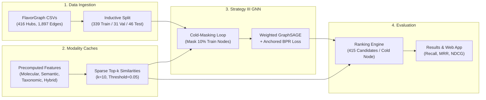

# Let There Be Flavour: Bridging the Cold-Start Gap in FlavorDB & FlavorGraph

[](https://www.python.org/downloads/)
[](LICENSE)
[](https://pytorch.org/)
[](https://streamlit.io/)
[](tests/run_tests.py)

> **Course:** Advanced Foundations of Machine Learning (UE24AM342AA1), Department of Computer Science & Engineering, PES University.  
> **Full Academic Report:** Available in **[reports/versioned_report_3_FINAL.md](reports/versioned_report_3_FINAL.md)**.

### Team Members
| Name | SRN |
|---|---|
| **Akshit Singhal** | PES1UG24AM027 |
| **Ahan A Mysore** | PES1UG24AM019 |
| **Aayushman Singh** | PES1UG24AM006 |
| **Abhay TS** | PES1UG24AM008 |

---


## Table of Contents

1. [Project Overview & Problem Statement](#1-project-overview--problem-statement)
2. [Documentation & Project Guides](#2-documentation--project-guides)
3. [Quickstart & Reproduction Guide](#3-quickstart--reproduction-guide)
4. [System Architecture & Pipelines Summary](#4-system-architecture--pipelines-summary)
5. [The Four Ingredient Modalities](#5-the-four-ingredient-modalities)
6. [Latest Observed Benchmark Results](#6-latest-observed-benchmark-results)
7. [Result Summary & In-Depth Analysis](#7-result-summary--in-depth-analysis)
8. [Interactive Web Application](#8-interactive-web-application)
9. [Known Limitations & Caveats](#9-known-limitations--caveats)
10. [Datasets & Original Papers](#10-datasets--original-papers)

---

## 1. Project Overview & Problem Statement

When a new culinary ingredient is introduced into a food database, nobody has yet cooked with it. In a culinary knowledge graph like [FlavorGraph](https://github.com/lamypark/FlavorGraph), this ingredient represents a **zero-degree cold-start node**: it has zero co-occurrence edges to other ingredients in the recipe network.

Standard Graph Neural Networks (GNNs) fail under zero-degree conditions because message passing relies on topological neighbors to aggregate information, and transductive embeddings (`nn.Embedding`) cannot generalize to unseen node IDs.

### Our Research Question
> *Can an inductive Graph Neural Network equipped with multi-modal pseudo-edges accurately predict recipe pairing affinities for zero-degree cold-start ingredients, or does non-deep-learning nearest-neighbor propagation suffice?*

### What We Built & Discovered
- **SavorLink Strategy III:** An inductive dual-branch GNN featuring weighted GraphSAGE convolutions, cold-masking training, anchored Bayesian Personalized Ranking (BPR) loss, and symmetric pairing prediction.
- **Four Distinct Modalities:** Chemistry (Morgan fingerprints via PubChem), Semantics (text embeddings via `all-MiniLM-L6-v2`), Taxonomy (3-tier culinary ontology), and Hybrid representations.
- **Leak-Free Benchmark:** A rigorous evaluation across 416 hub ingredients, with 562 ground-truth test pairs derived from Recipe1M Normalized Pointwise Mutual Information (NPMI).
- **Core Scientific Finding:** **The nearest-neighbor baseline (kNN) decisively beats Strategy III across all four modalities by 2.7x to 4.6x on Recall@10.** The GNN does not beat a simple Popularity baseline and rapidly overfits to warm training nodes. Borrowing recipe partners from chemically, taxonomically, or semantically similar known ingredients is vastly superior to neural message passing for this task.

---

## 2. Documentation & Project Guides

To ensure modularity and ease of inspection on GitHub, technical documentation is partitioned into specialized guides:

| Document | Description |
|---|---|
| **[ARCHITECTURE.md](ARCHITECTURE.md)** | **Full System Architecture:** Philosophy, mathematical formulations (`WeightedSAGEConv`, symmetric head, anchored BPR), inductive constraints, component tables, and hardware compliance audits. |
| **[setup.md](setup.md)** | **Setup & Operations Guide:** Prerequisites, one-click `setup.bat`, manual installation (Linux, macOS, Windows), CLI execution flags, and comprehensive troubleshooting. |
| **[docs/pipelines.md](docs/pipelines.md)** | **Pipelines Reference:** In-depth technical description of all 9 current and overall pipelines (data ingestion, feature caching, cold-masking, training, benchmarking, serving). |
| **[docs/modalities.md](docs/modalities.md)** | **Representations Reference:** Feature dimensions, RDKit Morgan fingerprints, `all-MiniLM-L6-v2` text embeddings, Wu-Palmer taxonomy trees, and hybrid similarity blending. |
| **[docs/evaluation.md](docs/evaluation.md)** | **Evaluation & Methodology:** Zero-degree ranking protocol, metric formulas (Recall@K, MRR, NDCG@K, Spearman $\rho$), candidate pool formulations, and the V2 vs V3 methodological post-mortem. |
| **[docs/datasets.md](docs/datasets.md)** | **Dataset Reference & Provenance:** Schemas, node/edge distributions, curation pipelines, licensing, and access links for all external databases. |
| **[reports/versioned_report_3_FINAL.md](reports/versioned_report_3_FINAL.md)** | **Version 3 Final Report:** Complete audit log, rationale for protocol corrections, and official multi-seed verification tables. |
| **`SavorLink_IEEE_Report.pdf`** | **Final Academic Paper (PDF):** Publication-grade write-up formatted according to IEEE conference standards. |

---

## 3. Quickstart & Reproduction Guide

### Windows (One-Click Setup)
Run the root automation script in Command Prompt:
```bat
setup.bat
```
*What this does:* Creates a virtual environment, installs dependencies, verifies the 19-test suite, executes the full multi-seed benchmark across all 4 modalities ($\approx 35\text{ seconds}$ on CPU), prints the terminal comparison table, and launches the Streamlit web app at <http://localhost:8501>.

*Helpful Windows Shortcuts:*
- `setup.bat results`: Instantly reprint the comparative evaluation table.
- `setup.bat app`: Launch the interactive Streamlit web dashboard.

### Linux / macOS (Manual Setup)
```bash
# 1. Environment & dependencies
python3 -m venv .venv
source .venv/bin/activate
pip install -r requirements.txt

# 2. Run test suite (19 tests)
python tests/run_tests.py

# 3. Train and benchmark all 4 modalities (seeds 42, 123, 456)
python -m src.run_benchmark

# 4. View terminal comparison & leaderboard
python -m src.compare

# 5. Launch interactive web dashboard
python -m streamlit run app/streamlit_app.py
```

### Google Colab GPU Execution
1. Bundle local assets: `python -m src.export_colab_bundle` (generates `data/colab_training_bundle.zip`, $\approx 4\text{ MB}$).
2. Open [`notebooks/colab_gpu_training.ipynb`](notebooks/colab_gpu_training.ipynb) in Google Colab.
3. Select **T4 GPU** runtime, upload the zip, and run all cells to execute the benchmark under CUDA acceleration.

---

## 4. System Architecture & Pipelines Summary



The system is decomposed into distinct, fully documented operational pipelines:
1. **Data Ingestion & Hub Filtering:** Subsets FlavorGraph to the 416 hub ingredients with chemical annotations, discarding 6,236 featureless zero-vector nodes.
2. **Multi-Modal Feature Extraction:** Computes Morgan fingerprints, sentence embeddings, multi-hot taxonomic vectors, and hybrid concatenations.
3. **Inductive Graph Splitting:** Isolates test ingredients and removes incident edges with automated leakage audits (`verify_no_leakage`).
4. **Dynamic Pseudo-Edge Construction:** Synthesizes weighted connections between isolated cold nodes and training hubs based on feature similarity.
5. **Inductive GNN Training:** Trains a 2-layer `WeightedSAGEConv` encoder with cold-masking and anchored pairwise BPR ranking loss.
6. **Multi-Seed Benchmarking:** Evaluates Random, Popularity, kNN, Zero-degree GNN, and Strategy III across seeds 42, 123, and 456.
7. **Interactive Web Serving:** Delivers visual graph before/after inspections and pairing predictions via Streamlit.

For deep architectural documentation, mathematical derivations, and data-flow specifications, see **[ARCHITECTURE.md](ARCHITECTURE.md)** and **[docs/pipelines.md](docs/pipelines.md)**.

---

## 5. The Four Ingredient Modalities

SavorLink represents ingredients across four diverse modalities:

```
+-----------------------------------------------------------------------------------------------+
|                                      FOUR MODALITIES                                          |
+-----------------------------------------------------------------------------------------------+
|  1. MOLECULAR (2048-d)                                                                        |
|     Mean-pooled 2048-bit Morgan Fingerprints (RDKit, radius 2) via PubChem SMILES.           |
|     Similarity: Set-based Mean Best Match (MBM) Tanimoto across compound sets.                |
+-----------------------------------------------------------------------------------------------+
|  2. SEMANTIC (384-d)                                                                          |
|     Sentence-Transformers 'all-MiniLM-L6-v2' embeddings of Wikipedia ingredient summaries.   |
|     Similarity: Cosine similarity between L2-normalized dense embeddings.                    |
+-----------------------------------------------------------------------------------------------+
|  3. TAXONOMIC (141-d)                                                                         |
|     3-tier categorical food hierarchy (Origin -> Group -> Subgroup) multi-hot encoding.       |
|     Similarity: Wu-Palmer ontological tree similarity based on Least Common Subsumer (LCS).   |
+-----------------------------------------------------------------------------------------------+
|  4. HYBRID (2432-d)                                                                           |
|     Concatenation of normalized Molecular (2048-d) and Semantic (384-d) feature vectors.      |
|     Similarity: 0.5 * Molecular_Tanimoto + 0.5 * Semantic_Cosine.                             |
+-----------------------------------------------------------------------------------------------+
```

For full implementation details, see **[docs/modalities.md](docs/modalities.md)**.

---

## 6. Latest Observed Benchmark Results

All metrics represent the **mean ± standard deviation across three random seeds (42, 123, 456)** evaluated on 46 held-out cold-start hub ingredients against all 415 candidate hubs (unpolluted Recipe1M ground truth).

### Reference Baselines (Modality-Independent)

| Baseline Model | Recall@10 | Recall@20 | MRR | NDCG@20 | Spearman $\rho$ |
|---|---|---|---|---|---|
| **Random** | 0.020 ± 0.003 | 0.041 ± 0.003 | 0.097 ± 0.018 | 0.029 ± 0.003 | −0.022 ± 0.025 |
| **Popularity** | 0.058 ± 0.015 | 0.114 ± 0.018 | 0.150 ± 0.042 | 0.083 ± 0.021 | 0.101 ± 0.057 |

### Multi-Modal Performance Comparison

| Modality | Model / Method | Recall@10 | Recall@20 | MRR | NDCG@20 | Spearman $\rho$ |
|---|---|---|---|---|---|---|
| **Taxonomic** | **Taxonomic-kNN** | **0.127 ± 0.012** | **0.189 ± 0.008** | **0.340 ± 0.055** | **0.184 ± 0.029** | **0.142 ± 0.062** |
| | Strategy III (GNN) | 0.035 ± 0.007 | 0.062 ± 0.020 | 0.131 ± 0.016 | 0.048 ± 0.009 | 0.032 ± 0.050 |
| | Zero-degree GNN | 0.024 ± 0.011 | 0.056 ± 0.025 | 0.088 ± 0.020 | 0.039 ± 0.015 | 0.065 ± 0.057 |
| **Semantic** | **Semantic-kNN** | **0.111 ± 0.003** | **0.187 ± 0.005** | **0.293 ± 0.041** | **0.165 ± 0.014** | **0.161 ± 0.092** |
| | Strategy III (GNN) | 0.030 ± 0.007 | 0.057 ± 0.017 | 0.126 ± 0.026 | 0.041 ± 0.014 | −0.057 ± 0.018 |
| | Zero-degree GNN | 0.033 ± 0.013 | 0.063 ± 0.014 | 0.137 ± 0.034 | 0.045 ± 0.014 | −0.044 ± 0.045 |
| **Hybrid** | **Hybrid-kNN** | **0.099 ± 0.004** | **0.161 ± 0.017** | **0.274 ± 0.014** | **0.142 ± 0.011** | 0.055 ± 0.073 |
| | Strategy III (GNN) | 0.021 ± 0.006 | 0.046 ± 0.013 | 0.101 ± 0.012 | 0.036 ± 0.009 | 0.011 ± 0.024 |
| | Zero-degree GNN | 0.036 ± 0.014 | 0.065 ± 0.019 | 0.128 ± 0.029 | 0.047 ± 0.013 | 0.057 ± 0.017 |
| **Molecular** | **Molecular-kNN** | **0.088 ± 0.007** | **0.148 ± 0.011** | **0.239 ± 0.011** | **0.127 ± 0.010** | 0.047 ± 0.069 |
| | Strategy III (GNN) | 0.032 ± 0.008 | 0.060 ± 0.007 | 0.127 ± 0.019 | 0.045 ± 0.008 | 0.067 ± 0.038 |
| | Zero-degree GNN | 0.032 ± 0.013 | 0.064 ± 0.025 | 0.130 ± 0.055 | 0.049 ± 0.022 | 0.091 ± 0.063 |

### Head-to-Head: kNN vs Strategy III (GNN)

| Modality | kNN Recall@10 | GNN Recall@10 | kNN NDCG@20 | GNN NDCG@20 | Outcome |
|---|---|---|---|---|---|
| **Taxonomic** | **0.127** | 0.035 | **0.184** | 0.048 | **kNN Wins (3.6x on Recall@10)** |
| **Semantic** | **0.111** | 0.030 | **0.165** | 0.041 | **kNN Wins (3.7x on Recall@10)** |
| **Hybrid** | **0.099** | 0.021 | **0.142** | 0.036 | **kNN Wins (4.6x on Recall@10)** |
| **Molecular** | **0.088** | 0.032 | **0.127** | 0.045 | **kNN Wins (2.7x on Recall@10)** |

### Global Leaderboard (Ranked by NDCG@20)

| Rank | Method | Modality | NDCG@20 | Recall@10 | MRR | Relative Strength |
|:---:|---|---|:---:|:---:|:---:|---|
| 🥇 | **kNN** | Taxonomic | **0.184** | **0.127** | **0.340** | `████████████████████` |
| 🥈 | **kNN** | Semantic | **0.165** | **0.111** | **0.293** | `██████████████████` |
| 🥉 | **kNN** | Hybrid | **0.142** | **0.099** | **0.274** | `███████████████` |
| 4 | **kNN** | Molecular | **0.127** | **0.088** | **0.239** | `██████████████` |
| 5 | **Popularity** | *Graph-wide* | **0.083** | **0.058** | **0.150** | `█████████` |
| 6 | **Strategy III** | Taxonomic | **0.048** | **0.035** | **0.131** | `█████` |
| 7 | **Strategy III** | Molecular | **0.045** | **0.032** | **0.127** | `█████` |
| 8 | **Strategy III** | Semantic | **0.041** | **0.030** | **0.126** | `████` |
| 9 | **Strategy III** | Hybrid | **0.036** | **0.021** | **0.101** | `████` |
| 10 | **Random** | *Uniform* | **0.029** | **0.020** | **0.097** | `███` |

---

## 7. Result Summary & In-Depth Analysis

### 1. kNN Baselines Decisively Outperform Every GNN Architecture
Across all four modalities, the simple non-deep-learning nearest-neighbor baseline (kNN) outperforms Strategy III by **2.7x to 4.6x on Recall@10**, **2.2x to 3.9x on Recall@20**, and **1.9x to 3.9x on NDCG@20**. Propagating recipe co-occurrence edges directly from an ingredient's top-$k$ feature neighbors provides an exceptionally strong inductive prior that message-passing layers fail to improve upon.

### 2. The Inductive GNN Fails to Beat Popularity
Strategy III fails to beat the simple Popularity baseline across all four modalities. Popularity achieves a Recall@10 of $0.058$ and NDCG@20 of $0.083$, whereas Strategy III scores between $0.021$ and $0.035$ on Recall@10 and $0.036$ to $0.048$ on NDCG@20. The GNN's predictions for cold nodes are less useful than simply recommending the most common recipe ingredients in the dataset.

### 3. Pseudo-Edges Do Not Reliably Assist the GNN
Comparing Strategy III against the Zero-Degree GNN (which evaluates the exact same GNN without pseudo-edge injection) reveals no meaningful benefit from pseudo-edges:
- **Molecular:** Strategy III Recall@10 = $0.032$ vs Zero-Degree = $0.032$ (identical).
- **Semantic:** Strategy III Recall@10 = $0.030$ vs Zero-Degree = $0.033$ (Zero-degree slightly higher).
- **Hybrid:** Strategy III Recall@10 = $0.021$ vs Zero-Degree = $0.036$ (Zero-degree significantly higher).
- **Taxonomic:** Strategy III Recall@10 = $0.035$ vs Zero-Degree = $0.024$ (modest pseudo-edge gain).
In 3 out of 4 modalities, adding pseudo-edges is within statistical noise or degrades performance.

### 4. Rapid Overfitting to Warm Nodes
Under inductive training, the GNN rapidly overfits to the warm training topology. Training loss steadily declines ($0.84 \rightarrow 0.60$), while validation loss on cold nodes rises ($0.69 \rightarrow 0.82$). In all 12 experimental runs, early stopping restored checkpoints from epochs 1, 2, or 3. Extending training to 300 epochs yielded identical test scores, confirming that message passing learns to exploit rich topological pathways between warm nodes that do not generalize through synthetic pseudo-edges.

### 5. Modality Hierarchy: Taxonomic > Semantic > Hybrid > Molecular
On NDCG@20 and Recall, the modalities rank consistently:
$$\text{Taxonomic-kNN } (0.184) > \text{Semantic-kNN } (0.165) > \text{Hybrid-kNN } (0.142) > \text{Molecular-kNN } (0.127)$$
Culinary recipes are governed primarily by cultural, culinary-role, and categorical compatibility (captured by taxonomy and natural language) rather than direct volatile aroma chemical overlap.

### 6. Methodological Audit: Version 2 vs Version 3
In earlier project reports (Version 1 & 2), Strategy III appeared to achieve near-perfect Recall and MRR. As detailed in [docs/evaluation.md](docs/evaluation.md), an audit revealed that Version 2 utilized FlavorGraph's metapath random-walk corpus, which generated 86,680 edges across 416 hubs (connecting almost every possible pair). This saturated ground truth forced Random baseline MRR to 1.000. Version 3 strictly evaluated against clean Recipe1M NPMI CSV edges, restoring a discriminating test bed.

When both training versions are compared on the clean ground truth:
- **V2 GNN training** scored higher than V3 ($0.060$ vs $0.035$ on taxonomic Recall@10).
- However, ablation demonstrates this occurred because V2 used **unanchored negative sampling**, allowing the model to minimize loss simply by memorizing global ingredient popularity ($0.060 \approx 0.058$ Popularity baseline).
- Neither GNN training approach comes close to **Taxonomic-kNN ($0.127$ Recall@10, $0.184$ NDCG@20)**.

---

## 8. Interactive Web Application

Launch the Streamlit dashboard:
```bash
python -m streamlit run app/streamlit_app.py
```

The web dashboard provides four interactive views:
1. **Overview Tab:** System architecture diagram, problem definition, and executive summary.
2. **Benchmark Tab:** Comparative bar charts with standard deviation error bars across all 5 metrics, head-to-head win-rate cards, and an interactive global leaderboard.
3. **Cold-Start Lab:** Single-ingredient inspection. Select any held-out test ingredient (e.g., `cheddar_cheese`, `sugar`, `jackfruit`) to observe:
   - *Phase 1:* Ground-truth recipe partners in the unperturbed graph.
   - *Phase 2:* Zero-degree isolation with all recipe edges severed.
   - *Phase 3:* Dynamic pseudo-edge synthesis and top-10 pairing predictions from kNN vs Strategy III GNN (with ground-truth hits highlighted).
4. **Semantic Context:** Natural language descriptors for each node, embedding representations, and cosine nearest neighbors, with an optional real-time sentence encoder.

---

## 9. Known Limitations & Caveats

1. **Template-Based Text Descriptions:** 289 of the 416 hub descriptions in `data/cache/wikipedia_summaries.json` share a standard template sentence. Consequently, semantic similarity largely captures lexical similarities in ingredient names.
2. **Rule-Based Taxonomy:** The 3-tier food hierarchy is implemented via curated lookup rules (`src/data/taxonomic_lookup.py`) rather than a full automated traversal of the complete FoodOn OWL ontology.
3. **Chemical Fingerprint Collisions:** The 416 hubs share 300 distinct pooled Morgan fingerprint vectors; certain unrelated foods (e.g., agave, abalone, acorn) share identical pooled vectors due to coarse compound mapping.
4. **Test Set Scale:** The evaluation pool consists of 46 held-out hubs and 562 ground-truth pairs per seed. While sufficient to discriminate Recall and NDCG, standard deviations for Spearman rank correlation are relatively wide.
5. **Stubbed Compound Inference:** `SavorLinkPredictor.predict_new_compounds()` is a placeholder that raises `NotImplementedError` and should not be used in production.

---

## 10. Datasets & Original Papers

This project relies on the following official, public academic datasets and ontological resources:

### 1. FlavorGraph
- **Original Paper:**  
  Park, D., Kim, K., Kim, S. et al. *"FlavorGraph: a large-scale food-chemical graph for generating food representations and recommending food pairings"*, *Scientific Reports* 11, 931 (2021).  
  - **Paper DOI:** [10.1038/s41598-020-79425-8](https://doi.org/10.1038/s41598-020-79425-8)  
  - **Nature Article Link:** [https://www.nature.com/articles/s41598-020-79425-8](https://www.nature.com/articles/s41598-020-79425-8)
- **Official Dataset Repository:**  
  - **GitHub:** [https://github.com/lamypark/FlavorGraph](https://github.com/lamypark/FlavorGraph) (Apache-2.0 License)

### 2. Recipe1M+
- **Original Papers:**  
  - Marin, J., Biswas, A., Ofli, F., Hynes, N., Salvador, A., Aytar, Y., Weber, I., & Torralba, A. *"Recipe1M+: A Dataset for Structured Recipe Representation"*, *IEEE Transactions on Pattern Analysis and Machine Intelligence* (TPAMI), 2019.  
    - **Paper DOI:** [10.1109/TPAMI.2019.2927439](https://doi.org/10.1109/TPAMI.2019.2927439)
  - Salvador, A., Hynes, N., Aytar, Y., Marin, J., Ofli, F., Weber, I., & Torralba, A. *"Inverse Cooking: Recipe Generation from Food Images"*, *IEEE/CVF Conference on Computer Vision and Pattern Recognition* (CVPR), 2019.
- **Official Dataset Website:**  
  - **URL:** [http://pic2recipe.csail.mit.edu/](http://pic2recipe.csail.mit.edu/)

### 3. FlavorDB
- **Original Paper:**  
  Garg, N., Sethupathy, A., Tuwani, R., Singh, R., Saha, S., Agarwal, N., & Bagler, G. *"FlavorDB: a resource of flavor molecules"*, *Nucleic Acids Research*, Volume 46, Issue D1, 4 January 2018, Pages D1210–D1216.  
  - **Paper DOI:** [10.1093/nar/gkx1094](https://doi.org/10.1093/nar/gkx1094)  
  - **Oxford Academic Link:** [https://academic.oup.com/nar/article/46/D1/D1210/4563459](https://academic.oup.com/nar/article/46/D1/D1210/4563459)
- **Official Database Portal:**  
  - **URL:** [https://cosman.iitd.ac.in/flavordb/](https://cosman.iitd.ac.in/flavordb/)

### 4. PubChem
- **Original Paper:**  
  Kim, S., Chen, J., Cheng, T. et al. *"PubChem 2023 update"*, *Nucleic Acids Research*, 51(D1), D1373–D1380 (2023).  
  - **Paper DOI:** [10.1093/nar/gkac956](https://doi.org/10.1093/nar/gkac956)
- **Official Database Portal:**  
  - **URL:** [https://pubchem.ncbi.nlm.nih.gov/](https://pubchem.ncbi.nlm.nih.gov/)

### 5. FoodOn (Food Ontology - Taxonomy)
- **Original Paper:**  
  Dooley, D.M., Griffiths, E.J., Gosal, G.S. et al. *"FoodOn: a harmonized ontologic resource in food, agriculture and nutrition"*, *npj Science of Food* 2, 23 (2018).  
  - **Paper DOI:** [10.1038/s41538-018-0032-6](https://doi.org/10.1038/s41538-018-0032-6)
- **Official Portal & GitHub Repository:**  
  - **URL:** [https://foodon.org/](https://foodon.org/)  
  - **GitHub:** [https://github.com/FoodOntology/foodon](https://github.com/FoodOntology/foodon)

---

## 11. Project Changelog & Archival Reports

Historical milestones and audit reports are preserved in `reports/`:
- **[versioned_reports.md](reports/versioned_reports.md):** Version 1 audit identifying empty PubChem cache and proposing the 4-modality architecture.
- **[versioned_report_2.md](reports/versioned_report_2.md):** Version 2 deployment (4 modalities, initial BPR, Colab export).
- **[versioned_report_3_FINAL.md](reports/versioned_report_3_FINAL.md):** Version 3 definitive audit correcting ground-truth saturation and establishing the leak-free benchmark.

---

## 12. License & Acknowledgements

This project is licensed under the **Apache License 2.0**.
- **FlavorGraph:** Developed by Park et al., used under Apache-2.0.
- **Embedding Models:** `sentence-transformers/all-MiniLM-L6-v2` developed by Hugging Face / Microsoft.