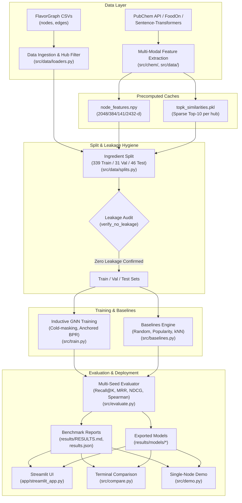

# SavorLink Pipelines Reference

This document provides a comprehensive, modular breakdown of all operational and overall pipelines within the SavorLink / Let There Be Flavour codebase. For high-level system architecture and module inventories, refer to [ARCHITECTURE.md](../ARCHITECTURE.md). For environment setup, see [setup.md](../setup.md).

---

## Table of Contents

1. [Overall End-to-End Pipeline](#1-overall-end-to-end-pipeline)
2. [Data Ingestion & Hub Filtering Pipeline](#2-data-ingestion--hub-filtering-pipeline)
3. [Multi-Modal Representation & Similarity Pipeline](#3-multi-modal-representation--similarity-pipeline)
4. [Inductive Graph Splitting & Leakage Verification Pipeline](#4-inductive-graph-splitting--leakage-verification-pipeline)
5. [Dynamic Pseudo-Edge Construction Pipeline](#5-dynamic-pseudo-edge-construction-pipeline)
6. [Inductive GNN Training & Optimization Pipeline](#6-inductive-gnn-training--optimization-pipeline)
7. [Multi-Seed Benchmarking & Evaluation Pipeline](#7-multi-seed-benchmarking--evaluation-pipeline)
8. [Inference, Single-Ingredient Demo & Web Serving Pipeline](#8-inference-single-ingredient-demo--web-serving-pipeline)
9. [Google Colab Cloud Training Pipeline](#9-google-colab-cloud-training-pipeline)

---

## 1. Overall End-to-End Pipeline

The overall pipeline transitions raw heterogeneous graph files and external databases into evaluated predictive models and interactive visual applications.



---

## 2. Data Ingestion & Hub Filtering Pipeline

- **Source Code:** `src/data/loaders.py`
- **Configuration:** `configs/default.yaml` (`data.hub_only: true`, `paths.raw_nodes`, `paths.raw_edges`)
- **Primary Inputs:**
  - `data/raw/nodes_191120.csv` (6,653 food ingredients + 1,561 flavor compounds)
  - `data/raw/edges_191120.csv` (Recipe1M normalized pointwise mutual information NPMI edges)

### Pipeline Steps:
1. **CSV Parsing:**
   - Reads node entries into typed `NodeInfo` dataclasses with `node_id`, `name`, `node_type`, `is_hub`, and `pubchem_cid`.
   - Reads edge entries into typed `EdgeInfo` dataclasses with `src`, `dst`, `edge_type` (`ingr-ingr`, `ingr-fcomp`, `ingr-dcomp`), and `score` (NPMI).
2. **Hub Filtering (`hub_only: true`):**
   - Out of 6,653 total ingredients in FlavorGraph, only 417 possess chemical compound annotations, of which 416 form the connected hub core.
   - When `hub_only` is enabled, all non-hub ingredients (which lack chemical compound links and would otherwise produce 6,236 empty feature vectors) are filtered out.
   - Co-occurrence edges are subset to pairs where both endpoints belong to the 416 hub set (yielding 1,897 undirected Recipe1M co-occurrence edges).
3. **Graph Data Structures:**
   - Constructs the `FlavorGraphData` container with bidirectional adjacency maps and degree indices.

---

## 3. Multi-Modal Representation & Similarity Pipeline

- **Source Code:**
  - `src/chem/fingerprints.py`: Chemical Morgan fingerprints and pooling
  - `src/chem/similarity.py`: Tanimoto similarity metrics and sparse top-k selection
  - `src/chem/semantic_embeddings.py`: Sentence-Transformers text encoding
  - `src/chem/taxonomic_similarity.py`: Wu-Palmer ontological similarity
  - `src/chem/hybrid_similarity.py`: Feature concatenation and similarity blending
  - `src/data/build_all_modalities.py`: End-to-end cache regeneration runner
- **Precomputed Outputs:** `data/cache/*.npy` and `data/cache/*.pkl`

### Pipeline Steps:

1. **Molecular Modality (2048-d):**
   - Retrieves SMILES from PubChem via PubChem CID (`src/data/pubchem_lookup.py`).
   - Computes 2048-bit Morgan circular fingerprints (radius 2) for each compound using RDKit.
   - Aggregates compound-level fingerprints to ingredient level via mean pooling (`pool_mean`).
   - Computes sparse top-$k$ similarity using `mean_best_match` Tanimoto across compound sets:
     $$\text{Sim}_{\text{MBM}}(I_A, I_B) = \frac{1}{2|C_A|} \sum_{c_i \in C_A} \max_{c_j \in C_B} T(c_i, c_j) + \frac{1}{2|C_B|} \sum_{c_j \in C_B} \max_{c_i \in C_A} T(c_i, c_j)$$
2. **Semantic Modality (384-d):**
   - Extracts descriptive text summaries for each food ingredient (`src/data/semantic_lookup.py`).
   - Encodes text with `sentence-transformers/all-MiniLM-L6-v2` into 384-dimensional $L_2$-normalized dense embeddings.
   - Computes dense cosine similarities and extracts top-$k$ neighbors per hub.
3. **Taxonomic Modality (141-d):**
   - Maps ingredients to a 3-tier ontological taxonomy (origin, group, subgroup) via rule-based lookup (`src/data/taxonomic_lookup.py`).
   - Converts hierarchical classifications into 141-dimensional multi-hot sparse feature vectors.
   - Computes Wu-Palmer ontological similarity based on depth and Least Common Subsumer (LCS).
4. **Hybrid Modality (2432-d):**
   - Concatenates $L_2$-normalized Molecular (2048-d) and Semantic (384-d) feature vectors.
   - Blends similarities: $\text{Sim}_{\text{Hybrid}} = 0.5 \cdot \text{Sim}_{\text{Molecular}} + 0.5 \cdot \text{Sim}_{\text{Semantic}}$.

---

## 4. Inductive Graph Splitting & Leakage Verification Pipeline

- **Source Code:** `src/data/splits.py`
- **Configuration:** `configs/default.yaml` (`splits.test_frac: 0.15`, `splits.val_frac: 0.10`, `splits.min_degree: 5`)

### Pipeline Steps:

1. **Candidate Eligibility Filtering:**
   - Evaluates node degree on the training recipe graph. Only hub nodes with degree $\ge 5$ in Recipe1M are eligible for test/val splits (ensuring ground-truth partners exist to evaluate ranking).
   - Among 416 hubs, 311 satisfy degree $\ge 5$.
2. **Disjoint Partitioning:**
   - Given random seed $s \in \{42, 123, 456\}$, randomly partitions eligible nodes:
     - **Test Set:** 46 ingredients ($\approx 15\%$)
     - **Validation Set:** 31 ingredients ($\approx 10\%$)
     - **Train Set:** Remaining 339 ingredients
3. **Edge Splitting & Ground Truth Isolation:**
   - Any edge connected to a validation or test ingredient is **completely removed** from the training graph.
   - Removed edges involving test ingredients with $\text{NPMI} > 0$ form the ground-truth pairing targets (562 test pairs per seed).
   - Removed edges involving validation ingredients form validation ground truth (351 val pairs per seed).
   - Training graph retains 1,043 edges strictly between training ingredients.
4. **Automated Leakage Audit (`verify_no_leakage`):**
   - Confirms pairwise disjoint sets: $\text{Train} \cap \text{Val} = \emptyset$, $\text{Train} \cap \text{Test} = \emptyset$, $\text{Val} \cap \text{Test} = \emptyset$.
   - Verifies that no edge in `train_edges` touches any node in $\text{Val} \cup \text{Test}$.
   - Verifies that pseudo-edge candidate pools and kNN candidate pools exclude other held-out nodes (preventing cold nodes from leaning on other cold nodes).

---

## 5. Dynamic Pseudo-Edge Construction Pipeline

- **Source Code:** `src/graph/pseudo_edges.py`, `src/graph/build_graph.py`
- **Configuration:** `configs/default.yaml` (`pseudo_edges.top_k: 10`, `pseudo_edges.threshold: 0.05`, `pseudo_edges.include_reverse: true`)

### Pipeline Steps:

1. **Cold Node Similarity Retrieval:**
   - For any zero-degree cold ingredient $u$, retrieves its top-$k$ nearest neighbors from the precomputed similarity dictionary.
   - Filters out any neighbor $v$ that belongs to the held-out test or validation set, or whose similarity falls below threshold ($0.05$).
2. **Pseudo-Edge Weight Assignment:**
   - Assigns the pairwise similarity score as the edge weight $w_{uv} = \text{Sim}(u, v)$.
   - Real recipe edges carry normalized co-occurrence NPMI scores ($w \in (0, 1]$), while pseudo-edges carry feature similarity scores ($w \in (0, 1]$).
3. **Bidirectional Injection & Merging:**
   - Adds reverse directed edges $(v, u)$ with equal weight $w_{uv}$ when `include_reverse: true`.
   - Merges real recipe edges and injected pseudo-edges into a single PyTorch sparse adjacency matrix (`edge_index` $[2, E]$, `edge_weight` $[E]$), marking pseudo-edges with a boolean mask `is_pseudo`.

---

## 6. Inductive GNN Training & Optimization Pipeline

- **Source Code:** `src/train.py`, `src/models/branches.py`, `src/models/heads.py`, `src/models/strategy3.py`
- **Configuration:** `configs/default.yaml` (`training.epochs: 100`, `training.lr: 0.001`, `training.patience: 15`, `training.neg_sample_ratio: 4`, `training.cold_mask_frac: 0.1`)

```
   Training Graph (1,043 Real Edges)
                │
                ▼
   Cold-Masking: Mask 10% of train nodes (zero their recipe edges)
                │
                ▼
   Dynamic Injection: Inject pseudo-edges for masked nodes (from top-k sim)
                │
                ▼
   Message Passing: 2 x WeightedSAGEConv (LayerNorm + Dropout)
                │
                ▼
   Link Head: MLP([h_u ⊙ h_v, h_u + h_v, |h_u - h_v|]) -> Raw Logits
                │
                ▼
   Anchored BPR Loss: Pos (u, v+) vs 4 Negs (u, w-) sharing anchor u
                │
                ▼
   Validation: Score cold val nodes -> Early stopping (patience=15)
```

### Pipeline Steps:

1. **Cold-Masking Simulation (Per Epoch):**
   - In each training epoch, 10% of training ingredients are randomly selected and "cold-masked".
   - All true recipe edges connected to these masked nodes are temporarily hidden.
   - Dynamic pseudo-edges are constructed for the masked nodes based on their top-$k$ training neighbors.
   - This forces the GNN to learn to embed nodes and predict pairings through pseudo-edges rather than memorizing topological graph positions.
2. **Inductive Forward Pass:**
   - Linear projection: $\mathbf{h}^{(0)}_u = \text{Dropout}(\text{ReLU}(\text{LayerNorm}(\mathbf{W}_{\text{in}} \mathbf{x}_u)))$.
   - Weighted GraphSAGE aggregation across 2 layers:
     $$\mathbf{h}^{(l+1)}_u = \text{ReLU}\left(\mathbf{W}_1^{(l)} \mathbf{h}^{(l)}_u + \mathbf{W}_2^{(l)} \frac{\sum_{v \in \mathcal{N}(u)} w_{uv} \mathbf{h}^{(l)}_v}{\sum_{v \in \mathcal{N}(u)} w_{uv} + \epsilon}\right)$$
   - Zero transductive ID embeddings (`nn.Embedding` is strictly prohibited).
3. **Symmetric Link Prediction Head:**
   - Computes permutation-invariant pair representations:
     $$\mathbf{\phi}(u, v) = [\mathbf{h}_u \odot \mathbf{h}_v \,\|\, \mathbf{h}_u + \mathbf{h}_v \,\|\, |\mathbf{h}_u - \mathbf{h}_v|]$$
   - Scores pairing logit: $s(u, v) = \text{MLP}(\mathbf{\phi}(u, v))$.
4. **Anchored BPR Ranking Loss:**
   - For every positive training edge $(u, v^+)$, samples 4 negative nodes $w^-$ from the candidate pool such that $(u, w^-)$ is not an edge.
   - Evaluates Bayesian Personalized Ranking on unconstrained logits:
     $$\mathcal{L}_{\text{BPR}} = -\sum_{(u, v^+)} \sum_{k=1}^4 \ln \sigma(s(u, v^+) - s(u, w^-_k))$$
   - Anchoring both positive and negative to the same base node $u$ forces the network to learn relative pairing preferences rather than global popularity.
5. **Validation & Checkpointing:**
   - Evaluates ranking loss on the held-out validation ingredients at every epoch.
   - Applies learning rate reduction (`ReduceLROnPlateau`, factor 0.5, patience 5).
   - Early stopping triggers after 15 epochs without validation loss improvement, restoring the best model checkpoint.

---

## 7. Multi-Seed Benchmarking & Evaluation Pipeline

- **Source Code:** `src/run_benchmark.py`, `src/evaluate.py`, `src/baselines.py`, `src/compare.py`
- **Output Files:** `results/RESULTS.md`, `results/results.json`, `results/models/<modality>/`

### Pipeline Steps:

1. **Benchmark Execution:**
   - Iterates across all 4 modalities ($\text{molecular}, \text{semantic}, \text{hybrid}, \text{taxonomic}$) and 3 fixed random seeds ($42, 123, 456$).
   - For each combination, trains Strategy III, exports checkpoints and artifacts, and evaluates 5 distinct models against the same test partition.
2. **Tested Methods:**
   - **Random Baseline:** Uniform random score assignment over candidate pool.
   - **Popularity Baseline:** Recommends candidate nodes ranked by their total weighted degree in the training graph.
   - **Modality kNN Baseline:** Propagates training partner edges from the cold node's top-$k$ nearest neighbors without any neural network:
     $$\hat{s}_{\text{kNN}}(u, c) = \frac{\sum_{v \in \mathcal{N}_{\text{sim}}(u)} w_{uv} \cdot \mathbf{A}_{\text{train}}(v, c)}{\sum_{v \in \mathcal{N}_{\text{sim}}(u)} w_{uv}}$$
   - **Zero-degree GNN:** Trained GNN evaluated on test nodes with feature inputs only (no pseudo-edges injected).
   - **Strategy III (Full Model):** Trained GNN evaluated with top-$k$ weighted pseudo-edges injected.
3. **Candidate Pool & Metrics Calculation:**
   - Every held-out test node ranks all other 415 hub ingredients as candidates.
   - Calculates 5 standard ranking metrics per cold node, aggregated across test nodes:
     - $\text{Recall}@10$: Fraction of ground-truth recipe partners recovered in top 10.
     - $\text{Recall}@20$: Fraction of ground-truth recipe partners recovered in top 20.
     - $\text{MRR}$ (Mean Reciprocal Rank): Reciprocal rank of the first true partner.
     - $\text{NDCG}@20$: Normalized Discounted Cumulative Gain graded by NPMI scores.
     - $\text{Spearman } \rho$: Rank correlation coefficient over the true partner set.
4. **Result Aggregation:**
   - Averages metric means and standard deviations across seeds 42, 123, 456.
   - Formats outputs into structured JSON (`results/results.json`) and GitHub-flavored markdown (`results/RESULTS.md`).

---

## 8. Inference, Single-Ingredient Demo & Web Serving Pipeline

- **Source Code:** `src/inference.py`, `src/demo.py`, `app/streamlit_app.py`
- **Invocation:**
  - Interactive Web App: `python -m streamlit run app/streamlit_app.py`
  - CLI Demonstration: `python -m src.demo --modality taxonomic --ingredient sugar`
  - Terminal Comparison: `python -m src.compare`

### Pipeline Steps:

1. **Model & Graph Artifact Loading (`src/inference.py`):**
   - Loads exported artifact bundle (`model_seed42.pt`, `graph_metadata.pkl`, `node_features.npy`, `inference_graph.npz`).
   - Reconstructs `SavorLinkPredictor` instance with trained weights and indexed training topology.
2. **Cold-Start Simulation & Prediction:**
   - Takes target ingredient (e.g., `sugar`, `jackfruit`, or custom user-defined entity).
   - Isolates node by masking any existing recipe edges.
   - Dynamically constructs top-$k$ pseudo-edges to training hubs based on feature similarity.
   - Runs GNN forward pass to compute pairwise affinity logits against all 415 candidates.
   - Simultaneously runs kNN neighbor propagation for side-by-side comparison.
3. **Streamlit UI Rendering (`app/streamlit_app.py`):**
   - **Tab 1 (Overview):** Problem statement, dataset statistics, and core findings.
   - **Tab 2 (Benchmark):** Interactive charts showing mean $\pm$ std error bars across all 5 metrics, modality breakdowns, head-to-head comparisons, and global leaderboard.
   - **Tab 3 (Cold-Start Lab):** Visual graph inspection of a chosen test ingredient: before isolation (real partners), during isolation (zero edges), and after pseudo-edge reconnection (with kNN and GNN predictions marked).
   - **Tab 4 (Semantic Context):** Inspects textual ingredient descriptions, feature embeddings, and cosine neighbors, with an optional live text encoding input box.

---

## 9. Google Colab Cloud Training Pipeline

- **Source Code:** `src/export_colab_bundle.py`, `notebooks/colab_gpu_training.ipynb`
- **Bundle File:** `data/colab_training_bundle.zip`

### Pipeline Steps:

1. **Bundle Packaging (`python -m src.export_colab_bundle`):**
   - Collects configuration (`configs/default.yaml`), raw graph files (`data/raw/*.csv`), precomputed modality caches (`data/cache/*.npy`, `data/cache/*.pkl`), and the entire `src/` source tree.
   - Compresses all required assets into a portable $\approx 4\text{ MB}$ archive (`data/colab_training_bundle.zip`).
2. **Colab Execution (`notebooks/colab_gpu_training.ipynb`):**
   - Cell 1: Detects GPU hardware and CUDA capability (Tesla T4).
   - Cell 2: Extracts uploaded `colab_training_bundle.zip`.
   - Cell 3: Verifies feature cache integrity across all 4 modalities.
   - Cell 4: Runs `python -m src.run_benchmark --seeds 42,123,456` under CUDA acceleration.
   - Cell 5: Renders generated `results/RESULTS.md`.
   - Cell 6: Automatically bundles and downloads `savorlink_colab_results.zip` containing all evaluation outputs and trained model weights.
